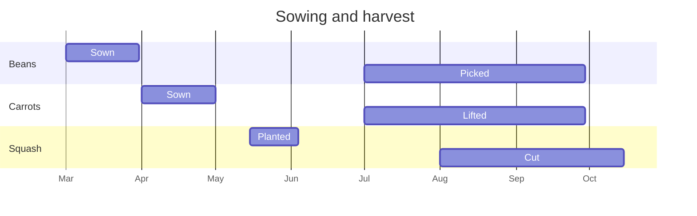
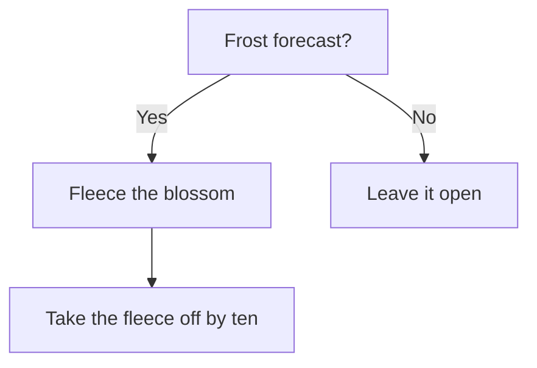

# Planting calendar

## The year as a diagram

A fence marked `mermaid` draws as a diagram, offline too.



## A decision as a diagram



## Code

```python
def rows(bed_length_cm: int, spacing_cm: int) -> int:
    """How many rows fit in a bed."""
    return bed_length_cm // spacing_cm
```

Inline code works too: `rows(240, 20)` gives `12`.

## Raw HTML in a note

A folded block:

<details><summary>Why sow salad every fortnight?</summary>

A short row every two weeks gives leaves all summer. One long row **bolts** all at once. See [[Allotment plan]].

</details>

A figure with a caption:

<figure>

![[allotment-beds.svg|The four beds and the fruit corner]]

<figcaption>The plot, seen from the gate.</figcaption>

</figure>

A keyboard key: press <kbd>/</kbd> to open Find.
