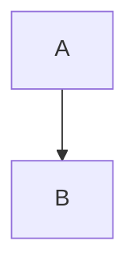

# Syntax #tour-heading

> [!warning] Mind the *step*
> A callout with a title.

> [!tip]- Folded
> Hidden until opened.

> [!custom-kind]
> A custom type.

Some ==highlighted== text, a %%hidden%% comment, and tags #garden and #plants/fern.

%%
A block comment with [[welcome]].
%%

A footnote.[^1]

[^1]: The footnote text.
